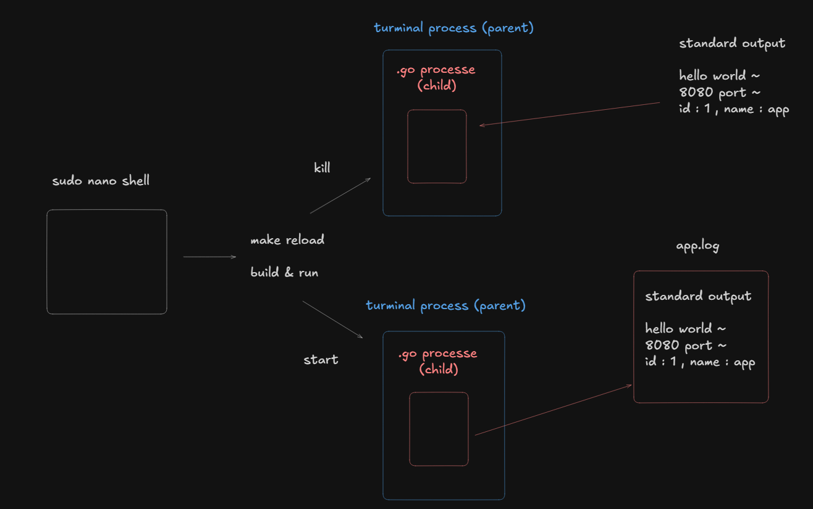

1. run make reload => start ./server 

2. when the make tast finishes and returns to the shell , Go server tries to print to 
standard output (child process)

3. run Go process in the background, decoupled from the parent terminal process using **nohup**
to prevent signal conflicts when the session ends. 
without this the parent and child process get tangled up with signals on session terminaltion
when trying to kill the process, because terminal still shows the Go server's standard output,
it ends up terminating the terminal itself rather than just killing the process

